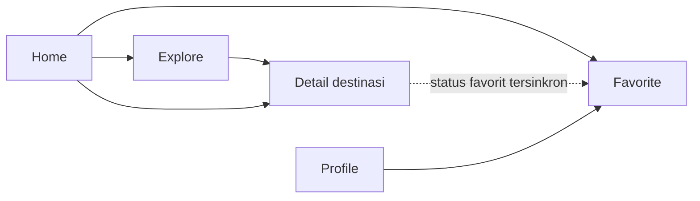

<div align="center">

# 🌸 Pink Travel

### Discover Beautiful Places, Create Wonderful Memories.

Aplikasi Flutter untuk menemukan inspirasi wisata Indonesia dengan tampilan feminin, modern, dan responsif.

[](https://flutter.dev)
[](https://dart.dev)
[](https://m3.material.io/)
[](https://commons.wikimedia.org/)

</div>

---

<details open>
<summary><strong>📚 Daftar isi — klik untuk membuka atau menutup</strong></summary>

- [Tentang aplikasi](#tentang-aplikasi)
- [Fitur](#fitur)
- [Cuplikan navigasi](#cuplikan-navigasi)
- [Teknologi](#teknologi)
- [Menjalankan project](#menjalankan-project)
- [Struktur project](#struktur-project)
- [Data dan foto](#data-dan-foto)
- [Pengujian](#pengujian)
- [Catatan](#catatan)

</details>

## Tentang aplikasi

**Pink Travel** adalah aplikasi eksplorasi destinasi wisata Indonesia. Pengguna dapat mencari tempat, menyaring kategori, melihat informasi destinasi, dan menyimpan tempat favorit.

Antarmuka menggunakan warna pink sebagai aksen, latar off-white, kartu rounded, ikon Lucide, dan komponen Material 3. Tampilan menyesuaikan ukuran layar ponsel, tablet, dan desktop/web.

## Fitur

| Bagian | Kemampuan |
| --- | --- |
| **Home** | Hero destinasi, pencarian, kategori, destinasi populer, dan rekomendasi |
| **Explore** | Pencarian berdasarkan nama/lokasi, filter kategori, urutan popularitas/rating, serta mode grid/list |
| **Detail** | Foto, lokasi, rating, harga, jam operasional, fasilitas, deskripsi, dan kredit foto |
| **Favorite** | Tambah/hapus favorit; daftar tersinkron dengan kartu dan detail selama aplikasi berjalan |
| **Profile** | Profil demo, jumlah favorit, informasi aplikasi, dan pengaturan demo |
| **Responsif** | Grid 2 kolom di ponsel, 3 di tablet, dan 4 di layar lebar |

### Cuplikan navigasi



## Teknologi

- **Flutter & Dart** — aplikasi lintas platform.
- **Material 3** — tema, navigasi, input, dan komponen dasar.
- **shadcn_flutter 0.0.55** — komponen tombol dan koleksi ikon Lucide.
- **Lottie 3.8.2** — dependensi animasi; saat ini folder animasi belum berisi JSON, sehingga empty state menggunakan ilustrasi fallback.
- **Wikimedia Commons** — foto destinasi eksternal, dimuat langsung dari URL tanpa disimpan ke project.

## Menjalankan project

Pastikan Flutter **3.47.7** dan Dart **3.13.5** tersedia, lalu jalankan dari root project:

```bash
flutter pub get
flutter run -d chrome
```

Untuk menjalankan di perangkat yang terhubung, gunakan:

```bash
flutter devices
flutter run -d DEVICE_ID
```

Ganti `DEVICE_ID` dengan ID perangkat yang ditampilkan oleh `flutter devices`.

Build aplikasi web:

```bash
flutter build web
```

## Struktur project

```text
t6_listviewgrid/
├── assets/
│   └── animations/       # Tempat file Lottie (opsional)
├── lib/
│   ├── main.dart         # Konfigurasi aplikasi dan tema
│   └── home_page.dart    # Halaman, data, navigasi, dan komponen utama
├── test/
│   └── widget_test.dart  # Pengujian UI dan interaksi
├── android/
├── ios/
├── linux/
├── macos/
├── web/
├── windows/
├── pubspec.yaml
└── README.md
```

Seluruh halaman dan komponen aplikasi dikelola dalam dua file Dart di `lib/`. Data destinasi berada di dalam `home_page.dart`.

## Data dan foto

Aplikasi berisi 12 destinasi demo: Kawah Putih, Pantai Kelingking, Raja Ampat, Bromo Tengger Semeru, Borobudur, Taman Nasional Komodo, Situ Patenggang, Curug Cimahi, Pantai Pink, Danau Toba, Malioboro, dan Nusa Penida.

- Foto dimuat langsung dari Wikimedia Commons dalam ukuran thumbnail hingga **1280 px**; tidak ada file foto yang perlu diunduh atau ditambahkan ke project.
- Koneksi internet diperlukan agar foto tampil. Jika foto gagal dimuat, aplikasi menampilkan placeholder.
- Kredit pembuat, lisensi, dan halaman sumber foto dicantumkan pada halaman detail destinasi.
- Nama kategori, rating, harga, jam operasional, fasilitas, dan deskripsi adalah data demo; periksa informasi resmi sebelum bepergian.

## Pengujian

Jalankan pemeriksaan kode dan widget test:

```bash
flutter analyze
flutter test
```

Widget test mencakup tampilan navigasi, penyaringan pencarian, serta penambahan dan penghapusan favorit.

## Catatan

<details>
<summary><strong>Favorit dan akun</strong></summary>

Project ini tidak memakai backend atau sistem login. Data favorit hanya disimpan selama aplikasi berjalan dan akan kembali kosong setelah aplikasi dimulai ulang.

</details>

<details>
<summary><strong>Animasi dan gambar tidak tampil?</strong></summary>

- Pastikan perangkat memiliki koneksi internet untuk memuat gambar eksternal.
- Folder `assets/animations/` belum memiliki file JSON Lottie. Empty state tetap berjalan menggunakan ilustrasi fallback.
- Android memerlukan izin `INTERNET`, yang sudah dicantumkan di manifest aplikasi.

</details>
